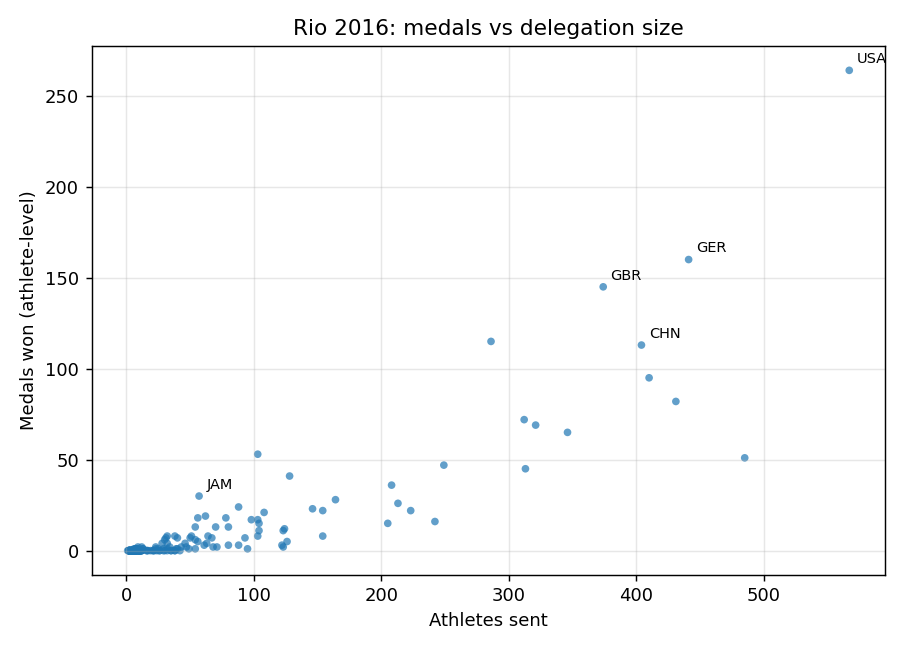

# Rio 2016: Do Bigger Delegations Win More Medals?

An exploratory analysis of the 2016 Rio Olympics athlete roster, asking a simple
question: **how strongly does the size of a country's delegation relate to the
number of medals it wins, and which countries are the most efficient per
athlete?**



## The question

Every four years the medal table is read as a ranking of sporting excellence,
but the medal table is also a ranking of delegation size: a country that sends
567 athletes has 567 chances to win something. This project measures how much of
the medal table is explained by delegation size alone, and then looks for the
countries that do unusually well (or badly) for their size.

## Dataset

| | |
|---|---|
| File | `olympia2016_athletes.csv` (11,538 rows, 11 columns) |
| Grain | one row per athlete |
| Columns used | `id`, `name`, `nationality`, `sex`, `height`, `weight`, `sport`, `gold`, `silver`, `bronze` |
| Source | the course-provided dataset for CISC7204 Tutorial 09 (`olympia2016_athletes.csv`, Rio 2016 athlete roster) |
| Permissions | obtained for coursework use; the raw file is **not redistributed** in this repository |

**The data file is not included here on purpose** — it was distributed for
course use and may not be redistributed. To reproduce the analysis, place the
file at `data/olympia2016_athletes.csv`. Any file with the same 11 columns works;
`data/README.md` documents the exact schema the notebook expects.

## Methods and tools

- **Python 3.10**, `pandas` for the aggregation, `matplotlib` for the static
  figures in `figures/`, `bokeh` for the interactive version inside the notebook.
- Per-country aggregation with `groupby("nationality").agg(...)`:
  `athletes = count(id)`, `gold/silver/bronze = sum(...)`, `medals = gold + silver + bronze`.
- **Pearson correlation** between delegation size and medal count.
- An **efficiency** metric, `medals / athletes`, computed only for countries
  with at least 20 athletes so that tiny delegations do not dominate the ranking.
- Everything lives in one notebook, `rio2016_medals.ipynb`, which runs top to
  bottom and writes the figures into `figures/`.

## Key findings

1. **Delegation size explains most of the medal table.** Across the 207
   countries that competed, `corr(athletes, medals) = 0.869`
   (`corr(athletes, gold) = 0.758`). The relationship is close to linear in the
   middle of the distribution and flattens at the top.
2. **Medals are highly concentrated.** Only **87 of 207** countries won anything
   at all, and the top eight (USA 264, GER 160, GBR 145, RUS 115, CHN 113,
   FRA 95, AUS 82, ITA 72) take the largest share of the 2,000-odd athlete-medal
   entries.
3. **Size is not the whole story.** The most efficient delegation with at least
   20 athletes is **Jamaica (57 athletes, 30 medals, 0.526 medals per athlete)**,
   ahead of Serbia (0.515), the USA (0.466), Russia (0.402) and Great Britain
   (0.388). The overall rate is 0.176 medals per athlete, so these countries are
   roughly three times more efficient than the field.

### One limitation

The medal columns are **athlete-level**, not event-level: a team gold (basketball,
relay, football) is counted once for *each* member of the squad. That is why the
USA shows 139 "gold" here versus 46 gold medals in the official Rio table.
Consequences: total medal counts are inflated for countries that are strong in
team sports, and the efficiency ranking is biased towards them. A corrected
version would deduplicate by event, which this dataset does not identify.

## Running the analysis

```bash
# 1. clone and enter the repository
git clone https://github.com/MC66129/data-science-project.git
cd data-science-project

# 2. create the environment
python -m venv .venv
source .venv/bin/activate        # Windows: .venv\Scripts\activate
pip install -r requirements.txt

# 3. put the dataset in place (see "Dataset" above)
mkdir -p data
# copy olympia2016_athletes.csv into data/

# 4. run the notebook
jupyter lab rio2016_medals.ipynb
```

Running the notebook top to bottom regenerates both figures in `figures/`.

## Repository layout

```
data-science-project/
├── README.md
├── requirements.txt
├── rio2016_medals.ipynb
├── figures/
│   ├── medals_vs_athletes.png
│   └── efficiency_top15.png
└── data/
    └── README.md          # schema of the expected CSV (no data committed)
```

## Project status

Ongoing — next step is to deduplicate medals by event so the efficiency ranking
is not biased by team sports.
